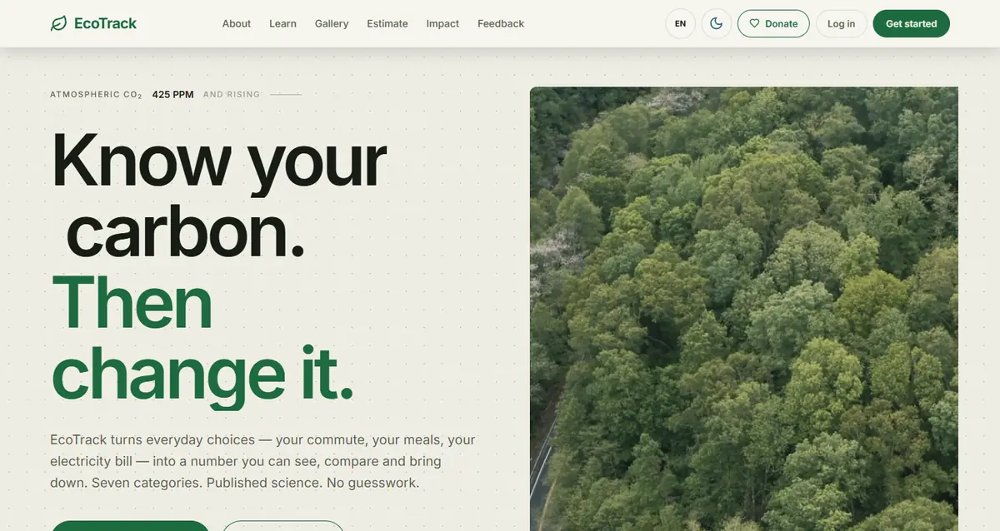
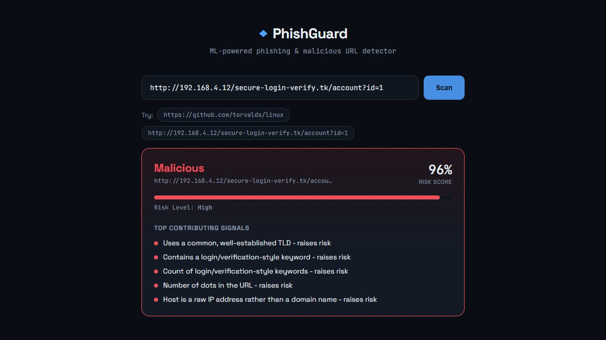
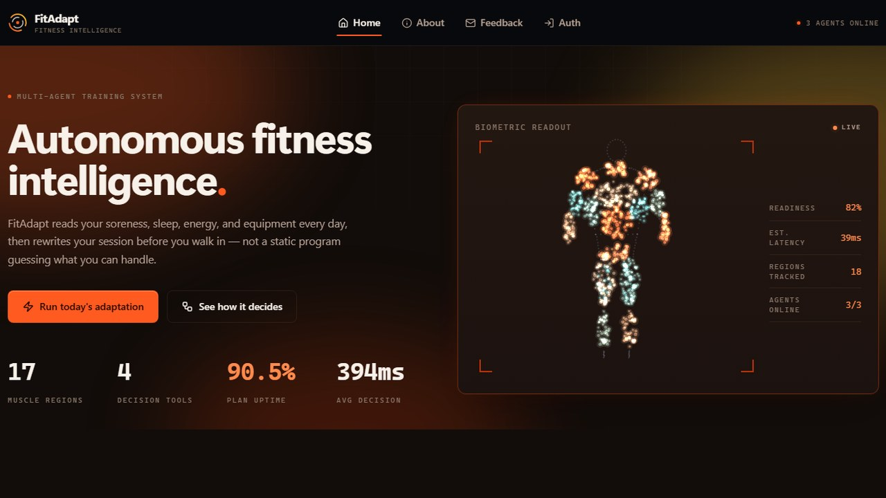
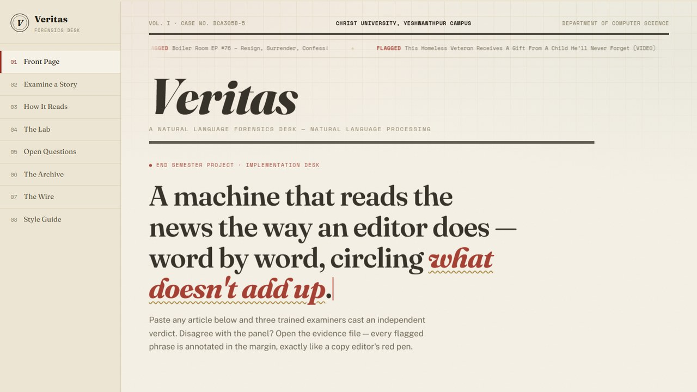
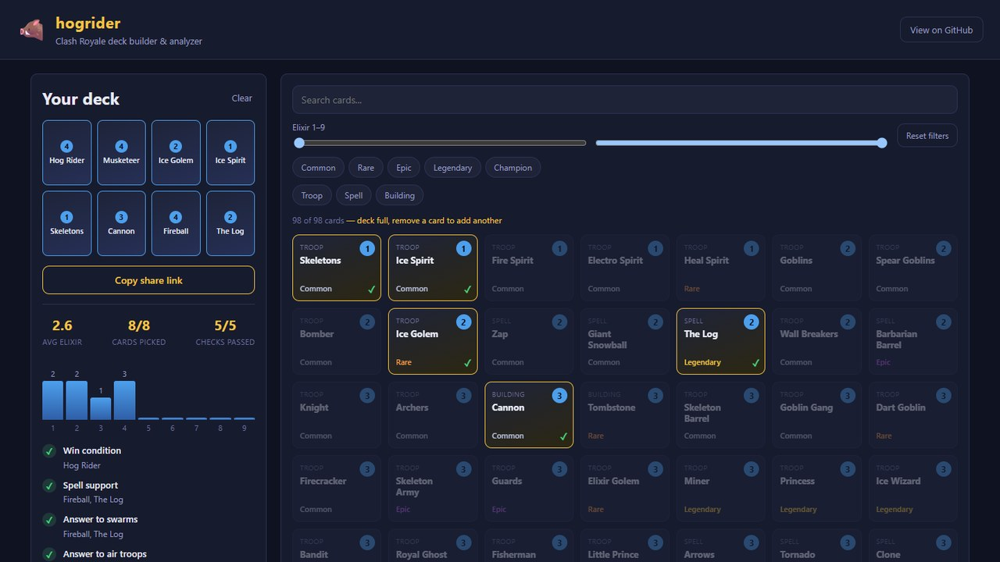
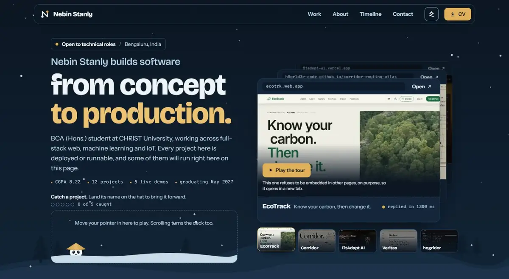

 &nbsp;&nbsp;&nbsp;&nbsp;

 

I'm a third-year BCA student at Christ University's Yeshwanthpur campus in Bangalore. I like taking things past the tutorial stage — every project below is something I actually built, ran end-to-end, and debugged until it worked, not just a "hello world."

Most of what I build sits somewhere between full-stack web dev, IoT, and real-time systems (WebSockets, live sync, that sort of thing), with more machine learning and NLP creeping in lately. I'm also slowly getting deeper into cybersecurity on the side.

The longer version, with my timeline, certificates and awards, is on my portfolio: **[h0gr1d3r-code.github.io](https://h0gr1d3r-code.github.io/)**

 

## Capstone project

### EcoTrack — know your carbon, then change it

A cloud-based carbon footprint tracker, built as my BCA specialization project and aligned with UN SDG 13 (Climate Action). You log everyday activity across seven categories — transport, electricity, fuel, diet, waste, water and consumption — and every entry is converted to kg of CO₂ with a published emission factor you can check.

- **Forecasts** your month-end footprint with an 80% prediction interval, backtested against a naive baseline
- **Recommends swaps** ranked by how much they save, each one citing the DEFRA / IPCC / CEA factors it was computed from
- **Scans bills** — photograph an electricity bill and a vision model reads the units for you to confirm
- **Compares you** against others in your region, k-anonymised so nobody is identifiable

`React` `Vite` `Flask` `Firebase Firestore` `Firebase Auth` `Chart.js` `GSAP`

**[Open EcoTrack](https://ecotrk.web.app)** &nbsp;·&nbsp; [Try the 30-second estimator](https://ecotrk.web.app/estimate) &nbsp;·&nbsp; [Code](https://github.com/H0GR1D3R-CODE/EcoTracker)

 

## Latest

### Corridor — an emergency-routing atlas for Bengaluru

Finds the fastest route for an ambulance when every road's travel time depends on the day, the hour, the weather and what is happening in the city. It routes over a graph of 832 junctions and 1,630 road segments, races five shortest-path algorithms on the same trip (Dijkstra, A\*, Bidirectional Dijkstra, Bellman–Ford, Greedy best-first), and backs its verdict with ten tests and a benchmark lab that run live in the browser. The board above is a recording of the real thing: every ambulance on it is being routed as you watch.

`JavaScript` `Graph algorithms` `No build step, no dependencies`

**[Open the atlas](https://h0gr1d3r-code.github.io/corridor-routing-atlas/)** &nbsp;·&nbsp; [Watch the 5-minute film](https://h0gr1d3r-code.github.io/corridor-routing-atlas/film/) &nbsp;·&nbsp; [Code](https://github.com/H0GR1D3R-CODE/corridor-routing-atlas)

 

## Featured

<table>
  <tr>
    <td width="50%" valign="top">
      
      <h3>PhishGuard</h3>
      
Paste a URL, get a verdict: safe, suspicious or malicious. A Random Forest trained on 6,494 real labelled URLs reads 24 features straight from the URL string, and SHAP explains in plain English which ones drove the call.

      
<code>Python</code> <code>FastAPI</code> <code>scikit-learn</code> <code>SHAP</code> <code>React</code> <code>Docker</code>

      
<a href="https://github.com/H0GR1D3R-CODE/phishguard">Code</a>

    </td>
    <td width="50%" valign="top">
      
      <h3>FitAdapt AI</h3>
      
Interactive front end for a multi-agent system that reads an athlete's soreness, sleep and energy each day and rewrites the training session to match. Includes a live Sensing → Decision → Execution pipeline you can step through.

      
<code>React</code> <code>Vite</code> <code>Tailwind CSS</code>

      
<b><a href="https://fitadapt-ai.vercel.app">Live</a></b> &nbsp;·&nbsp; <a href="https://github.com/H0GR1D3R-CODE/fitadapt-ai">Code</a>

    </td>
  </tr>
</table>

<table>
  <tr>
    <td width="50%" valign="top">
      
      <h3>Veritas</h3>
      
Fake news detection with classic NLP: TF-IDF features into Logistic Regression, SVM and Random Forest, behind a dashboard that shows every stage of the pipeline running on the article you paste in. Built with Don Pradeep.

      
<code>Python</code> <code>scikit-learn</code> <code>NLTK</code> <code>Flask</code>

      
<b><a href="https://fake-news-detection-nlp.vercel.app">Live</a></b> &nbsp;·&nbsp; <a href="https://github.com/H0GR1D3R-CODE/fake-news-detection-nlp">Code</a>

    </td>
    <td width="50%" valign="top">
      
      <h3>hogrider</h3>
      
Clash Royale deck builder. Pick 8 cards and get a live elixir curve and matchup checks (win condition, spell support, answers to swarms, air and tanks). Decks live in the URL, so sharing one is just copying the link.

      
<code>React</code> <code>Vite</code> <code>GitHub Pages</code>

      
<b><a href="https://h0gr1d3r-code.github.io/hogrider/">Live</a></b> &nbsp;·&nbsp; <a href="https://github.com/H0GR1D3R-CODE/hogrider">Code</a>

    </td>
  </tr>
</table>

 

## More projects

| Project | What it does | Stack |
|---|---|---|
| [**collabcanvas**](https://github.com/H0GR1D3R-CODE/collabcanvas) | Real-time collaborative whiteboard — multiple people draw together live with cursor presence, boards persist and can be shared via a room link | React · Socket.IO · Node/Express · MongoDB |
| [**campus-connect**](https://github.com/H0GR1D3R-CODE/campus-connect) | Campus club & event management platform with role-based auth (student / club admin / site admin) and RSVPs | React · Node/Express · MongoDB · JWT |
| [**iot-environment-monitor**](https://github.com/H0GR1D3R-CODE/iot-environment-monitor) | ESP32 + DHT22 sensor pipeline (with a software simulator) publishing live to ThingSpeak, plus a Python analysis & alerting layer | Arduino/C++ · Python · ThingSpeak API |
| [**expense-tracker-android**](https://github.com/H0GR1D3R-CODE/expense-tracker-android) | Native Android expense tracker with budget tracking and a hand-drawn category breakdown chart | Kotlin · Jetpack Compose · Room · MVVM |
| [**library-management-system**](https://github.com/H0GR1D3R-CODE/library-management-system) | Console-based library system — issue/return workflow with automatic overdue fine calculation | Java · JDBC · SQLite |
| [**finance-analyzer-cli**](https://github.com/H0GR1D3R-CODE/finance-analyzer-cli) | CLI tool that analyzes personal income/expenses from CSV data — category breakdowns, monthly trends, exported charts | Python · pandas · matplotlib |

 

## Toolbox

<table>
  <tr>
    <td><b>Languages</b></td>
    <td></td>
  </tr>
  <tr>
    <td><b>Web</b></td>
    <td></td>
  </tr>
  <tr>
    <td><b>Data &amp; ML</b></td>
    <td></td>
  </tr>
  <tr>
    <td><b>Devices &amp; tools</b></td>
    <td></td>
  </tr>
</table>

 

## Portfolio

A deck of my projects you can flip through, a small game where you catch a project's name on the panda's hat, and a timeline of study, certificates, volunteering and awards: **[h0gr1d3r-code.github.io](https://h0gr1d3r-code.github.io/)**

 

Christ University, Yeshwanthpur &nbsp;·&nbsp; Bangalore, India &nbsp;·&nbsp; <a href="mailto:nebinstanly12@gmail.com">nebinstanly12@gmail.com</a>

